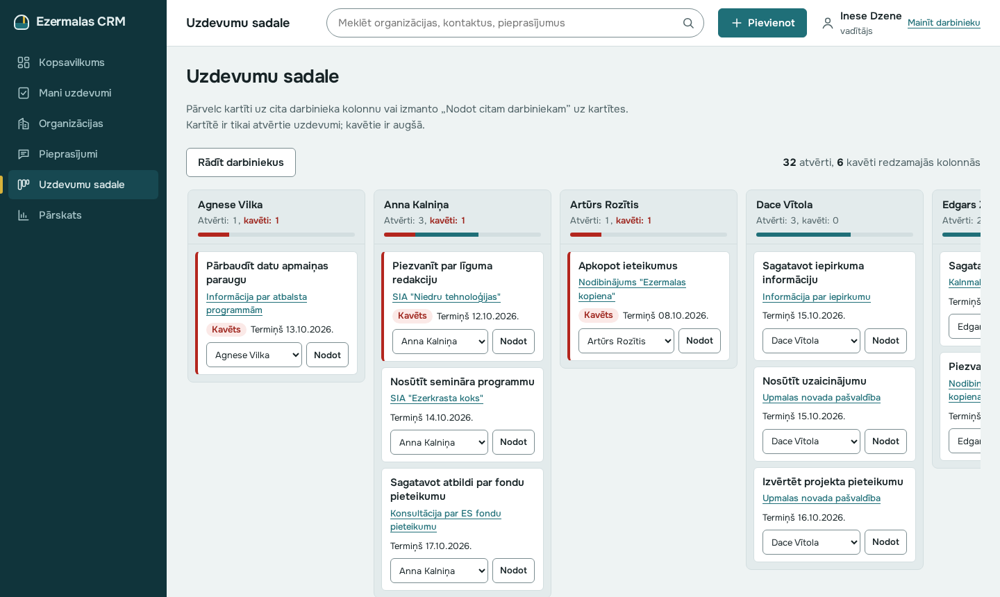

# Ezermalas CRM

[](https://github.com/tehnikaatbildigais/m1-setup-check2/actions/workflows/ci.yml)

Klientu attiecību sistēmas (CRM) prototips iestādei ar ~25 darbiniekiem, kas sadarbojas ar
uzņēmumiem, NVO un pašvaldībām. Sistēma aizstāj Excel tabulas un personīgos e-pastus:
vienuviet redzamas organizācijas, to kontaktpersonas, saziņas vēsture, pieprasījumi un
darbinieku uzdevumi.

> Mācību projekts. Ezermalas novada pašvaldība un visi dati ir izdomāti. Sistēma darbojas
> mācību režīmā bez pieteikšanās, tāpēc tajā nedrīkst ievadīt īstus personas datus.



## Saturs

- [Iespējas](#iespējas)
- [Tehnoloģijas](#tehnoloģijas)
- [Ātrā palaišana](#ātrā-palaišana)
- [Lomas un mācību režīms](#lomas-un-mācību-režīms)
- [Konfigurācija](#konfigurācija)
- [Projekta struktūra](#projekta-struktūra)
- [Testēšana](#testēšana)
- [API līgums](#api-līgums)
- [Piekļūstamība](#piekļūstamība)
- [Datu aizsardzība](#datu-aizsardzība)
- [Darba process](#darba-process)
- [Dokumentācija](#dokumentācija)
- [Zināmie ierobežojumi](#zināmie-ierobežojumi)
- [Licences](#licences)

## Iespējas

| Sadaļa | Ko dara |
|---|---|
| **Kopsavilkums** | Pēc ienākšanas: mani uzdevumi šodien, kavētie un tuvāko 7 dienu pieprasījumi, pēdējo 7 dienu mijiedarbības. Vadītājam un administratoram arī iestādes kopskaitļi |
| **Organizācijas** | Uzņēmumi, NVO, pašvaldības ar reģ. nr. un atbildīgo darbinieku; kartītē kontaktpersonas, mijiedarbību hronoloģija, pieprasījumi, uzdevumi |
| **Kontaktpersonas** | Tikai sadarbībai vajadzīgie dati ar VDAR tiesisko pamatu; glabāšanas termiņš 2 gadi pēc pēdējās saziņas |
| **Mijiedarbības** | Zvans, e-pasts, sanāksme ar dalībniekiem, kopsavilkumu un nākamo soli. **MI kopsavilkums**: no brīvām piezīmēm 3 teikumi un ieteikums, marķēts „Ģenerēts ar MI”, darbinieks pārbauda un apstiprina |
| **Pieprasījumi** | Statuss Jauns → Darbā → Atbildēts, fiksēts 30 dienu termiņš, kavētie atzīmēti ar tekstu |
| **Uzdevumi** | Saistīti ar organizāciju vai pieprasījumu; „Mani uzdevumi šodien” |
| **Uzdevumu sadale** | Vadītāja tāfele: kolonnas ir darbinieki, kartītes ir uzdevumi. Pārvelc kartīti vai izmanto „Nodot citam darbiniekam” |
| **Meklēšana** | Viens lauks pāri organizācijām, kontaktpersonām un pieprasījumiem |
| **Pārskats** | Aktivitāte pa darbiniekiem (diagramma un tā pati tabula), kavētie pieprasījumi, aktīvākās organizācijas izvēlētā periodā |
| **Administrēšana** | Lomas, kontaktpersonas ar beigušos glabāšanas termiņu, piekļuves žurnāls, piekļūstamības atsauksmes |
| **Lietotāju konti** | Reģistrācija, pieteikšanās ar bloķēšanu pēc 3 kļūdām, paroles atjaunošana (`/login`). Atsevišķi no CRM mācību režīma |

## Tehnoloģijas

- **Python 3.12**, [FastAPI](https://fastapi.tiangolo.com/), [Jinja2](https://jinja.palletsprojects.com/) (servera pusē renderēts HTML)
- **SQLite** (bez atsevišķa datubāzes servera)
- JavaScript tikai kā uzlabojums: visas funkcijas darbojas arī bez tā
- [Anthropic Claude API](https://docs.anthropic.com/) (nav obligāts) MI kopsavilkumam
- Testi: pytest, Playwright + axe-core pieejamībai
- Izstrādes vide: GitHub Codespaces (`.devcontainer/`)

## Ātrā palaišana

### GitHub Codespaces (ieteicams)

1. Repozitorija lapā izvēlies **Code → Codespaces → Create codespace on main**.
2. Kad vide ir gatava, terminālī:

   ```bash
   make install
   make run
   ```

3. Atver pārsūtīto portu **8000** (VS Code cilne **Ports**) un pārlūkā atveras sākumlapa.

### Lokāli

Vajag Python 3.12 un `make`.

```bash
git clone https://github.com/tehnikaatbildigais/m1-setup-check2.git
cd m1-setup-check2
python -m venv .venv && source .venv/bin/activate
pip install fastapi uvicorn pydantic httpx pytest pyyaml openapi-spec-validator
make install
make run
```

Atver <http://localhost:8000/>.

> Codespaces konteinerā FastAPI, Uvicorn, pytest un līguma pārbaudes rīki jau ir uzstādīti;
> `requirements.txt` satur tikai to, kas vajadzīgs papildus (Jinja2, python-multipart,
> anthropic).

### Pirmā ienākšana

Pirmajā palaišanā datubāzē tiek ievietoti izdomāti sākumdati: 25 darbinieki, 10 organizācijas,
20 kontaktpersonas, 95 mijiedarbības, 43 pieprasījumi un 35 uzdevumi. Sākumlapā izvēlies
darbinieku, piemēram:

| Darbinieks | Loma | Ko redzēt |
|---|---|---|
| Anna Kalniņa | darbinieks | Savas 2 organizācijas, uzdevumi šodien, citas organizācijas tikai lasīšanai |
| Inese Dzene | vadītājs | Uzdevumu sadale, pārskats, iestādes kopskaitļi |
| Rūta Saulīte | administrators | Viss, plus administrēšana |

Lai sāktu no jauna ar svaigiem sākumdatiem, apturi serveri un izdzēs `data/crm.db`.

## Lomas un mācību režīms

CRM nav paroles: sākumlapā izvēlas darbinieku, un viņa loma nosaka tiesības.

| Darbība | Darbinieks | Vadītājs | Administrators |
|---|:---:|:---:|:---:|
| Skatīt visas organizācijas | ✓ | ✓ | ✓ |
| Labot organizāciju, kontaktus, mijiedarbības, pieprasījumus | tikai savas | ✓ | ✓ |
| Uzdevumu sadale, pārskats | | ✓ | ✓ |
| Mainīt lomas, dzēst kontaktpersonas, piekļuves žurnāls, atsauksmes | | | ✓ |

Lietotāju konti (`/login`, `/register`) ir atsevišķs modulis ar parolēm, bloķēšanu un paroles
atjaunošanu. CRM tos pašlaik neizmanto.

## Konfigurācija

Visi iestatījumi ir vides mainīgie; neviens nav obligāts.

| Mainīgais | Noklusējums | Nozīme |
|---|---|---|
| `CRM_DB_PATH` | `data/crm.db` | CRM datubāzes fails |
| `AUTH_DB_PATH` | `data/users.db` | Lietotāju kontu datubāzes fails |
| `PUBLIC_BASE_URL` | `http://localhost:8000` | Adrese paroles atjaunošanas saitei. Jāiestata, ja lietotne darbojas citā adresē |
| `ANTHROPIC_API_KEY` | nav | Ja iestatīts, MI kopsavilkumam izmanto Claude; citādi atslēgvārdu imitāciju |
| `A11Y_REQUIRED` | nav | `1`: pieejamības testi krīt, ja nav Playwright vai Chromium (citādi tiek izlaisti) |

Mape `data/` netiek komitēta.

**Paroles atjaunošana** prototipā nesūta e-pastu: saite tiek ierakstīta servera žurnālā
(terminālī, kur darbojas `make run`).

## Projekta struktūra

```text
app/
  application.py      lietotnes izveide (create_app)
  main.py             ieejas punkts uvicorn
  auth.py             lietotāju konti: reģistrācija, pieteikšanās, paroles atjaunošana
  security.py         paroļu jaukšana (scrypt), marķieri
  db.py               SQLite savienojumi un transakcijas
  errors.py           kļūdu atbildes: HTML pārlūkam, JSON citiem klientiem
  pages.py            pieteikšanās lapas
  crm/
    schema.py         datubāzes shēma un sintētiskie sākumdati
    web.py            veidnes, tiesības, piekļuves žurnāls, formu validācija
    orgs.py           organizācijas, kontaktpersonas, mijiedarbības
    work.py           pieprasījumi un uzdevumi
    board.py          uzdevumu sadales tāfele
    overview.py       sākumlapa, kopsavilkums, meklēšana, pārskats, administrēšana
    ai.py             MI kopsavilkums (imitācija vai Claude)
    chart.py          SVG diagramma pārskatam
    templates/        Jinja2 veidnes
  static/             CSS, JavaScript, fonti, pieteikšanās lapas
docs/                 API līgums, prasības, klasifikācijas un audita dokumenti
tests/                pytest un pārlūka pieejamības testi
tools/                API līguma pārbaudes rīks
tracker/              eksportēti pieteikumi (CR-0 … CR-7)
```

## Testēšana

```bash
make test             # visi testi
make lint-contract    # API līguma pārbaude
```

**Pieejamības testi** (`tests/a11y_check.py`) darbojas pārlūkā ar axe-core un Playwright. Bez
tiem `make test` šos testus izlaiž. Lai tos palaistu:

```bash
make install-dev      # Playwright un Chromium ar sistēmas bibliotēkām
A11Y_REQUIRED=1 make test
```

Testi izmanto pagaidu datubāzes un nekad neaiztiek `data/`.

| Fails | Pārbauda |
|---|---|
| `tests/test_auth.py` | Lietotāju konti, bloķēšana, paroles atjaunošana |
| `tests/test_crm.py` | CRM funkcijas, tiesības, VDAR, līguma atbilstība maršrutiem |
| `tests/test_board.py` | Uzdevumu sadales tāfele |
| `tests/a11y_check.py` | axe-core visās lapās, tastatūra, 320 px, teksta atstarpes, darbība bez JavaScript |
| `tests/test_smoke.py` | Līguma ielāde un obligātie faili |

**CI** (GitHub Actions) katrā push un pull request palaiž `make test` un `make verify-setup`.
`make verify-setup` papildus pārbauda Claude Code un failu `setup/claude-answer.md`.

## API līgums

[`docs/openapi.yaml`](docs/openapi.yaml) ir patiesības avots visiem maršrutiem: lietotāju kontu
JSON API (`/auth/*`) un CRM HTML ekrāniem. Ja programma darbojas citādi, nekā rakstīts līgumā,
tā ir kļūda vienā no tiem. Pēc līguma maiņas palaid `make lint-contract`.

Kad lietotne darbojas, `/auth/*` operācijas var izmēģināt Swagger UI: <http://localhost:8000/docs>.

Līguma daļas `/health` un `/submissions` ir nepabeigtas apzināti (pieteikums CR-2), tāpēc
`make lint-contract` pašlaik ziņo par 7 kļūdām tieši tur.

## Piekļūstamība

Mērķis ir WCAG 2.2 AA (EN 301 549), kā to prasa MK noteikumi Nr. 445 un Direktīva (ES) 2016/2102.

- Katrā lapā: saite „Pāriet uz saturu”, orientieri, redzams fokuss, saite uz piekļūstamības paziņojumu.
- Formas: etiķetes, kļūdas pie laukiem, kļūdu kopsavilkums ar fokusu.
- Statuss nekad netiek norādīts tikai ar krāsu; gaišais un tumšais režīms.
- Vilkšanai tāfelē ir alternatīva poga (WCAG 2.5.7).
- Viss darbojas arī bez JavaScript.

Piekļūstamības paziņojums un atsauksmju forma: <http://localhost:8000/pieklustamiba>.

## Datu aizsardzība

- Kontaktpersonām tikai sadarbībai vajadzīgie lauki ar VDAR tiesisko pamatu.
- Kontaktpersonas, ar kurām nav bijusi saziņa 2 gadus, tiek parādītas administratoram dzēšanai.
- Dzēšot kontaktpersonu, viņas vārds tiek aizstāts ar „Dzēsta kontaktpersona” visos ierakstos.
- Piekļuves žurnālā (kas, ko, kad skatīja vai mainīja) ir tikai ierakstu ID, ne personas dati.
- MI kopsavilkumam brīvās piezīmes netiek saglabātas.
- Paroles tiek glabātas tikai kā scrypt jaucējvērtības.

MI organizāciju prioritizācija netiek veidota; pamatojums: [`docs/mi2_klasifikacija.md`](docs/mi2_klasifikacija.md).

## Darba process

Darba noteikumi ir [`CLAUDE.md`](CLAUDE.md). Īsumā:

1. Katrai izmaiņai ir pieteikums mapē [`tracker/`](tracker/) (veidne: `tracker/_template.md`).
   Pieteikumus maina tikai uzskaites sistēmā; repozitorijā tie ir eksports.
2. Viens pieteikums = viens zars = viens pull request. Zara, komita un PR nosaukums sākas ar
   pieteikuma ID, piemēram, `CR-7: …`.
3. Pirms komita palaid `make test` un, ja mainīts līgums, `make lint-contract`.
4. Komitā nedrīkst būt piekļuves dati vai personas dati.

## Dokumentācija

| Dokuments | Saturs |
|---|---|
| [`docs/prasibas_arhitektura.md`](docs/prasibas_arhitektura.md) | Prasības (F1–F9, MI-1, MI-2, N1–N4) un konceptuālā arhitektūra |
| [`docs/openapi.yaml`](docs/openapi.yaml) | API līgums |
| [`docs/mi2_klasifikacija.md`](docs/mi2_klasifikacija.md) | MI akta klasifikācija organizāciju prioritizācijai |
| [`docs/audits-2026-10-14.md`](docs/audits-2026-10-14.md) | Koda un piekļūstamības audits un labojumi |
| [`tracker/`](tracker/) | Pieteikumi CR-0 … CR-7 |

## Zināmie ierobežojumi

- CRM darbojas mācību režīmā bez pieteikšanās; jebkurš var izvēlēties jebkuru lomu.
- Lietotāju kontu sesijām nav derīguma termiņa, un sīkdatnei nav `Secure` atzīmes (lokālam
  prototipam ar http).
- Paroles atjaunošanas saite netiek sūtīta pa e-pastu.
- Nav veikta piekļūstamības pārbaude ar ekrānlasītāju; paziņojumā statuss ir „daļēji atbilst”.
- Pilns saraksts: [`docs/audits-2026-10-14.md`](docs/audits-2026-10-14.md), sadaļa „Atrasts, bet nav labots”.

## Licences

Projekta kodam licence nav norādīta. Iekļautie trešo pušu faili:

| Fails | Licence |
|---|---|
| `app/static/fonts/onest-*.woff2` (Onest) | SIL Open Font License 1.1, `app/static/fonts/Onest-OFL.txt` |
| `app/static/fonts/schibsted-grotesk-*.woff2` (Schibsted Grotesk) | SIL Open Font License 1.1, `app/static/fonts/OFL.txt` |
| `tests/vendor/axe.min.js` (axe-core 4.10.3) | Mozilla Public License 2.0, `tests/vendor/axe-core-LICENSE.txt` |
