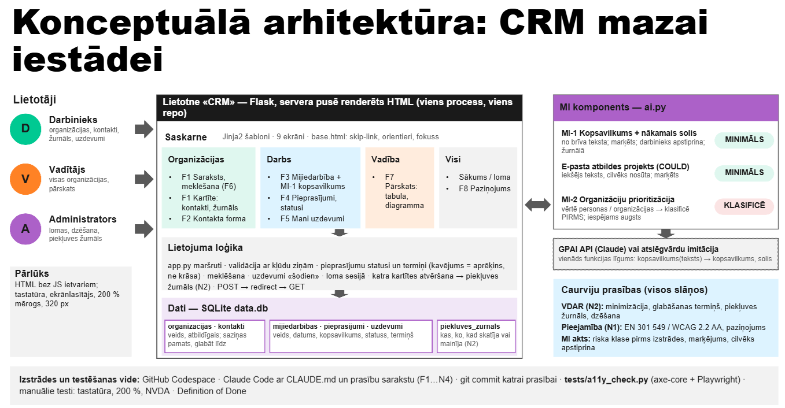

Situācija: iestāde ar ~25 darbiniekiem sadarbojas ar uzņēmumiem, NVO un pašvaldībām — konsultācijas, semināri, pieprasījumi. Šodien viss ir Excel tabulās un personīgajos e-pastos: neviens nezina, kas ar ko pēdējo reizi runāja. Vajadzīga viena klientu attiecību sistēma (CRM).​

 
ID​

Prasība​

Pieņemšanas kritērijs (iesk. pieejamību, MI, VDAR)​

F1​

Organizācijas: izveidot, rediģēt, meklēt​

Nosaukums, reģ. nr., veids (uzņēmums / NVO / pašvaldība), atbildīgais darbinieks; forma ar label un kļūdu tekstiem​

F2​

Kontaktpersonas pie organizācijas​

Vārds, amats, e-pasts, tālrunis, saziņas pamats un datums; tikai vajadzīgie lauki (VDAR)​

F3​

Mijiedarbību žurnāls​

Zvans / e-pasts / sanāksme: datums, dalībnieki, kopsavilkums, nākamais solis; hronoloģija organizācijas kartītē​

F4​

Pieprasījumi no organizācijām​

Statuss Jauns → Darbā → Atbildēts; termiņš; kavētie izcelti ar tekstu, ne tikai krāsu​

F5​

Uzdevumi un atgādinājumi​

«Mani uzdevumi šodien»; atzīmēt kā izpildītu; saistīti ar organizāciju vai pieprasījumu​

F6​

Meklēšana​

Viens lauks pāri organizācijām, kontaktiem, pieprasījumiem; rezultāti tabulā ar caption un th scope​

F7​

Pārskats vadītājam​

Aktivitāte pa darbiniekiem, kavētie pieprasījumi, aktīvākās organizācijas; diagramma + tā pati tabula​

F8​

Piekļūstamības paziņojums​

Lapa /pieklustamiba ar reāliem testa atradumiem; saite kājenē​

MI-1​

Mijiedarbības kopsavilkums un nākamā soļa ieteikums​

No brīva teksta → 3 teikumi + ieteikums; marķēts «Ģenerēts ar MI»; darbinieks rediģē un apstiprina; žurnālā​

MI-2​

Organizāciju prioritizācija «pēc sadarbības potenciāla»​

TIKAI klasificēt (MI akts): kas tiek vērtēts, kādas sekas organizācijai / personai; lēmums «būvēt vai nē»​

N1​

Pieejamība​

EN 301 549 / WCAG 2.2 AA; axe bez critical/serious; tastatūra un 200 % mērogs galvenajā ceļā​

N2​

Personas dati (VDAR)​

Datu minimizācija; glabāšanas termiņš kontaktam; piekļuves žurnāls (kas skatīja kartīti); dzēšana pēc pieprasījuma​

N3​

Lomas​

Darbinieks — savas organizācijas; vadītājs — visas + pārskats; lomu izvēlas sākumlapā (bez paroļu, mācību režīms)​

N4​

Tehnoloģijas un laiks​

Flask + Jinja2 + SQLite; Codespace + Claude Code; 1,5 h; sākumdati: 10 organizācijas, 20 kontakti, 30 mijiedarbības​

